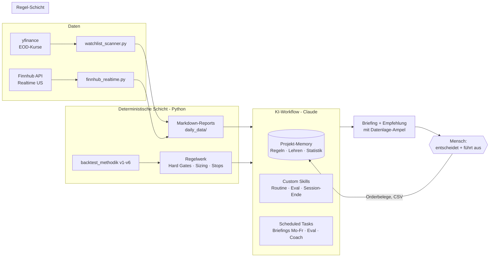

# TRADING – LEVEL UP · AI Trading Workbench

**Ein systematisches, regelbasiertes Swing-Trading-Projekt als Engineering-Aufgabe:**
deterministische Python-Tools für Marktdaten und Backtests, eine vollständig dokumentierte
Regel-Methodik — und ein KI-gestützter Arbeits-Workflow (Claude) mit Memory-Architektur,
Custom Skills und automatisierten Briefings.

> **English abstract:** A personal research project that treats systematic swing trading
> as an engineering problem. Deterministic Python tooling (watchlist scanner, realtime
> quotes, out-of-sample backtests) computes the numbers; a documented rule system
> (hard gates, risk-based position sizing, staged stops) governs decisions; and an
> LLM-based workflow (Claude with persistent memory, custom skills, scheduled briefings
> and self-evaluation) handles analysis, documentation and process discipline.
> The human makes and executes every trading decision. Not investment advice.

---

## Warum dieses Repo

Die meisten Trading-Projekte scheitern nicht an fehlenden Ideen, sondern an fehlender
Disziplin und fehlendem Prozess. Dieses Projekt setzt deshalb drei Schichten übereinander:

1. **Deterministischer Code** rechnet alle Zahlen (Indikatoren, Regime, Volumen-Gates,
   Backtests). Ein Sprachmodell schätzt hier nichts — Zahlen kommen ausschließlich aus
   Python bzw. verifizierbaren Datenquellen.
2. **Ein schriftliches Regelwerk** (Hard Gates, Sizing, Stops, Exits) macht jede
   Entscheidung prüfbar und jeden Fehler auswertbar → [docs/METHODIK.md](docs/METHODIK.md)
3. **Ein KI-Workflow** übernimmt Briefings, Checks, Dokumentation und Selbst-Evaluation —
   mit klarer Arbeitsteilung: die KI analysiert und dokumentiert, der Mensch entscheidet
   und führt aus → [docs/KI_WORKFLOW.md](docs/KI_WORKFLOW.md)

## Komponenten

| Datei | Zweck |
|---|---|
| `scanner/watchlist_scanner.py` | Ein Lauf → eine Markdown-Tabelle über alle Positions- und Pipeline-Werte: EMA-Stack (Stage-2 Tag/Woche nach Weinstein), RSL nach Levy, annualisierte Volatilität, Momentum, Volumen-Gate, Abstand zum 52-Wochen-Hoch, Chase-Warnung. Dazu Markt-Regime: Nasdaq-100-Gate, VIX, Fear-&-Greed, SPDR-Sektor-Heatmap, ATR-Überhitzungs-Check. |
| `scanner/finnhub_realtime.py` | Realtime-Quotes (US) über die Finnhub-API, nur Standardbibliothek. API-Key ausschließlich über Umgebungsvariable oder lokale Key-Datei — nie im Code. |
| `scanner/run_scanner.bat` | Automatischer Tageslauf über die Windows-Aufgabenplanung, mit Logfile. |
| `backtest/backtest_methodik_v6.py` | 6. Iteration der Backtest-Reihe: Out-of-sample-Validierung einer Regime-Regel (Nasdaq-Gate nur für Tech-Werte) auf zwei unabhängigen Achsen — getrennte Zeitfenster (in-sample 2021–2023 vs. out-of-sample 2024–2026) und ein frisches, zurückgehaltenes Aktien-Set. Mit dokumentierten Caveats (Survivorship-Bias). |
| `docs/METHODIK.md` | Das vollständige Regelwerk: Hard Gates, risikobasiertes Sizing, gestaffeltes Stop-System, Exit-Pfade, Pipeline, Journal. |
| `docs/KI_WORKFLOW.md` | Architektur des KI-gestützten Workflows: Memory, Skills, Automatisierung, Guardrails. |

## Architektur



## Setup

```bash
pip install -r requirements.txt
# Finnhub-Key (kostenlos, https://finnhub.io/register), EINE Variante:
#   setx FINNHUB_API_KEY "DEIN_KEY"        (Windows, danach neues Terminal)
#   oder finnhub_key.txt neben das Skript legen (steht in .gitignore)
python scanner/watchlist_scanner.py
python scanner/finnhub_realtime.py NVDA CAT
python backtest/backtest_methodik_v6.py
```

Für den automatischen Tageslauf: `scanner/run_scanner.bat` in der Windows-Aufgabenplanung
registrieren (z. B. täglich 22:05, nach US-Börsenschluss).

## Datenquellen und bewusste Grenzen

Der Scanner nutzt yfinance (US-Kurse ~15 Min verzögert, vor US-Open Vortagesschluss) —
für Tagesschluss-Analysen ausreichend, für Intraday-Trigger ergänzt `finnhub_realtime.py`
echte Realtime-Quotes. RSL und Volatilität sind nahe, aber nicht bit-identische
Äquivalente zu kommerziellen Screener-Werten; solche Abweichungen sind im Code und in
den Reports explizit gekennzeichnet statt verschwiegen. Der Backtest dokumentiert seinen
Survivorship-Bias und wertet deshalb Bedingungs-Vergleiche aus, keine Absolutrenditen.

Diese Beispiel-Konfiguration enthält **keine echten Positions-, Depot- oder Kontodaten** —
im Live-Betrieb werden die Konfigurationsblöcke mit den eigenen Werten gepflegt.

## Disclaimer

Privates Forschungs- und Lernprojekt. **Keine Anlageberatung, keine Handelsempfehlung.**
Gehebelte Produkte können zum Totalverlust führen. Jede Verantwortung für
Handelsentscheidungen liegt beim Handelnden selbst.

## Autor

Günter Kohlhofer — IT-Techniker mit ~10 Jahren Berufspraxis, Schwerpunkt-Interessen:
systematisches Trading, KI-gestützte Arbeitsprozesse, Automatisierung.

## Lizenz

MIT — siehe [LICENSE](LICENSE).
